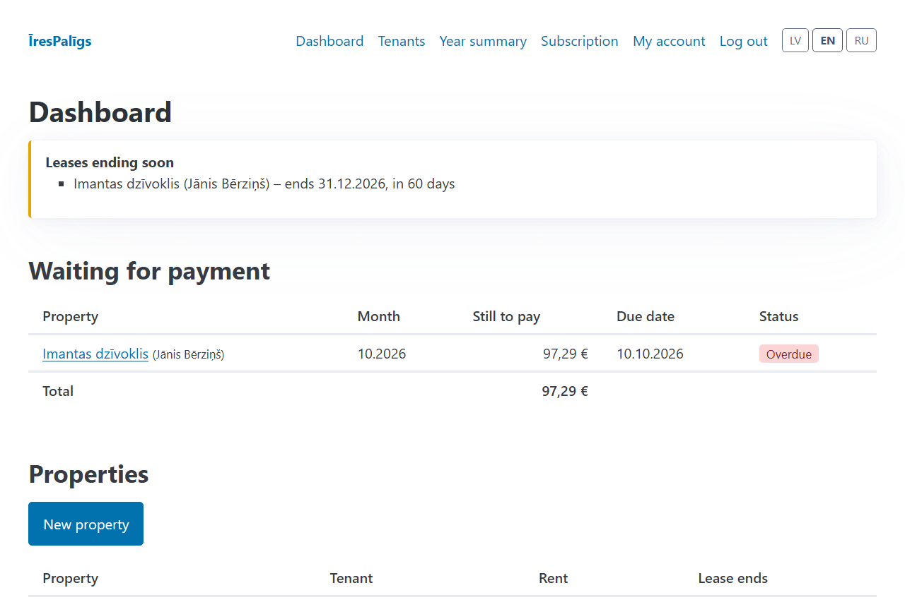
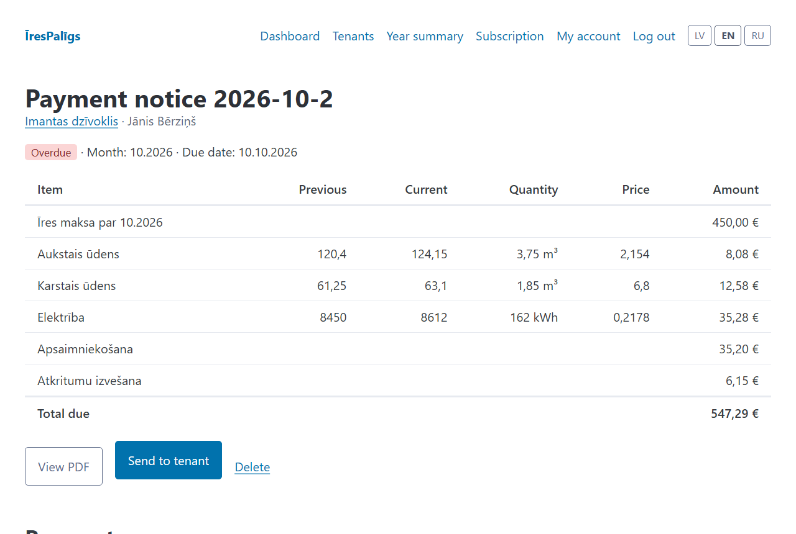
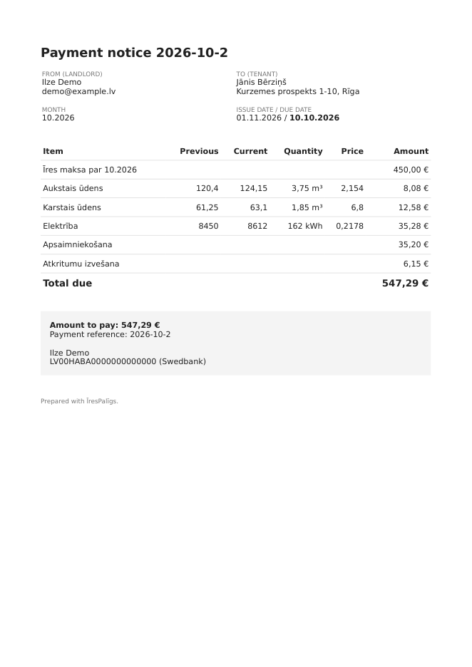
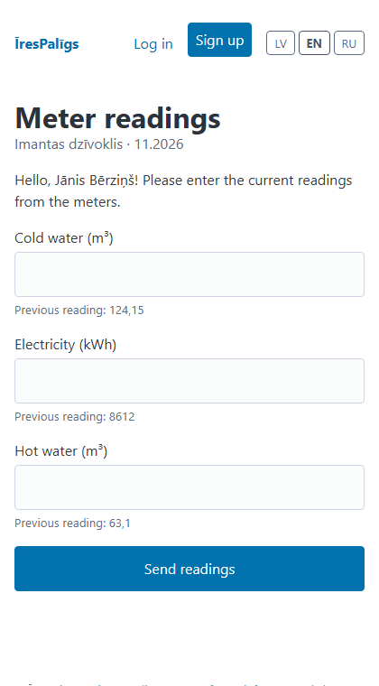

# ĪresPalīgs


**A subscription web app for private landlords in Latvia.** Enter the monthly meter readings –
ĪresPalīgs calculates the utilities, prepares a payment notice (PDF), emails it to the tenant and
keeps track of who has paid. Latvian first, with English and Russian.

> **Status:** working MVP, not yet launched publicly. Built as a product project: from idea and
> specification to a tested, deployable application.



## Why

Many Latvians rent out one or two flats. Every month they collect water, electricity and heating
readings, calculate the bill by hand, message the tenant and check the bank statement – usually in
Excel and WhatsApp. ĪresPalīgs turns that into a two-minute routine and reminds the landlord of the
dates that matter (overdue rent, lease end, tax notifications).

## Features

- **Properties, tenants and leases** – one active lease per property, fixed-term leases, deposit
  limited to two months' rent as the Residential Tenancy Law requires.
- **Monthly payment notices** – rent + metered utilities (`(current − previous) × price`) + fixed
  charges, exact `Decimal` arithmetic with half-up rounding per line, PDF generation and email to the
  tenant. Each notice stores a snapshot of its numbers, so later price changes never alter old notices.
- **Tenant self-service** – the tenant submits meter readings through a private link, no account needed;
  the landlord's next notice is pre-filled.
- **Payments** – full and partial payments, overdue detection, dashboard of what is still unpaid.
- **Reminder emails** – one daily digest per landlord (reading day, overdue rent, lease ending in
  60/30 days, VID notification for new leases, unregistered pre-2021 leases), each sent only once.
- **Year-end summary** – billed vs. received per property, CSV for Latvian Excel and PDF.
- **Subscriptions** – 14-day trial, free and paid plan, Stripe Checkout and Customer Portal, signed and
  idempotent webhooks.
- **GDPR** – minimal personal data (no personal identity codes), "download all my data" (ZIP) and
  "delete my account", EU-only hosting, privacy policy and cookie notice.
- **Three languages** – Latvian (default), English, Russian; Latvian formats everywhere
  (`dd.mm.yyyy`, `1 234,56 €`).
- **Admin** – Django admin for support and a metrics page (trials, paying users, activation, MRR).

| Payment notice | PDF sent to the tenant | Tenant's readings form (mobile) |
|---|---|---|
|  |  |  |

## Tech stack

| Area | Choice |
|---|---|
| Backend | Python 3.12, Django 5.2 LTS |
| Database | PostgreSQL 17 |
| Frontend | Server-rendered Django templates, Pico.css (no JavaScript framework) |
| Auth | django-allauth – email + password and one-time login codes |
| Payments | Stripe (Checkout, Customer Portal, webhooks) |
| PDF | WeasyPrint |
| Tests | pytest + pytest-django (110+ tests), GitHub Actions |
| Dev / deploy | Docker Compose locally; Render Blueprint (Frankfurt, EU) |

## Engineering highlights

- **Owner scoping everywhere.** Every query on user data goes through `Model.objects.for_owner(user)`;
  tests check that one landlord gets a 404 on another landlord's properties, notices and payments.
- **Money is never a float.** All amounts are `Decimal`, rounded half-up per line; the total is the sum
  of the rounded lines, so the PDF always adds up.
- **Business logic lives in plain functions** (`apps/*/services.py`) – easy to read and unit-test.
- **External services are never called in tests.** Stripe webhooks are tested with real signature
  verification against a test secret; emails go to Django's in-memory outbox.
- **Rules from law are traceable.** Every tax or legal assumption is marked in code and listed with its
  official source in [VERIFY.md](VERIFY.md).

## Project documents

- [SPEC.md](SPEC.md) – persona, user stories, MVP scope, pricing, success metric
- [ARCHITECTURE.md](ARCHITECTURE.md) – stack decisions, data model, auth, payments, deployment
- [VERIFY.md](VERIFY.md) – legal and tax assumptions with sources and status
- [CONTRIBUTING.md](CONTRIBUTING.md) – commands, coding conventions and rules for the project

## Run it locally

You need [Docker Desktop](https://www.docker.com/products/docker-desktop/).

```bash
docker compose up --build
```

Then, in a second terminal, load demo data and open http://localhost:8000:

```bash
docker compose run --rm web python manage.py seed_demo
```

Demo login: `demo@example.lv` / `demo-parole-2026` (local development only). No `.env` file is needed;
emails (sign-up confirmations, login codes) are printed in the `docker compose up` output.

### Common tasks

| What | Command |
|---|---|
| Run tests | `docker compose run --rm web pytest` |
| Send today's reminder emails | `docker compose run --rm web python manage.py send_reminders` (add `--date 01.12.2026` to simulate another day) |
| Create an admin user | `docker compose run --rm web python manage.py createsuperuser` → http://localhost:8000/admin/ |
| After changing a model | `docker compose run --rm web python manage.py makemigrations` |
| After changing UI text | `docker compose run --rm web python manage.py makemessages -l lv -l en -l ru --ignore=staticfiles`, translate in `locale/*/LC_MESSAGES/django.po`, then `compilemessages --ignore=staticfiles` |
| Database shell | `docker compose exec db psql -U irespaligs` |
| Start from an empty database | `docker compose down -v` (deletes all local data) |

### Project layout

```
irespaligs/          settings, URLs, Latvian date/number formats
apps/core/           language selection, money formatting, owner scoping
apps/accounts/       user model (email login), profile, admin metrics
apps/rentals/        properties, tenants, leases, meters, tenant readings link
apps/statements/     payment notices, PDF/email, payments, year summary
apps/reminders/      daily reminder emails
apps/subscriptions/  plans, trial, Stripe (providers/ for future bank-link payments)
apps/privacy/        GDPR data export and account deletion
apps/pages/          landing page, dashboard, legal pages, cookie notice
templates/  locale/  static/  tests/
```

## Payments in test mode

Without Stripe keys the app works normally; the subscription page says payments are not configured.
To try checkout with Stripe **test mode**: create two recurring prices (4,99 EUR/month and
49,90 EUR/year, tax behaviour "inclusive"), put `STRIPE_SECRET_KEY`, `STRIPE_PRICE_MONTHLY` and
`STRIPE_PRICE_YEARLY` in `.env`, forward webhooks with
`stripe listen --forward-to localhost:8000/stripe/webhook/` and set `STRIPE_WEBHOOK_SECRET`, then pay
with the test card `4242 4242 4242 4242`.

## Deployment

[`render.yaml`](render.yaml) describes the web service, PostgreSQL database and the daily reminder job,
all in Render's Frankfurt region. Secrets (Stripe, email) are entered in Render, never committed –
see [`.env.example`](.env.example) for every setting.

## Licence

Copyright © 2026 Roberts Rudzītis. All rights reserved – the code is public for viewing and evaluation;
please ask before reusing it. See [LICENSE](LICENSE).
